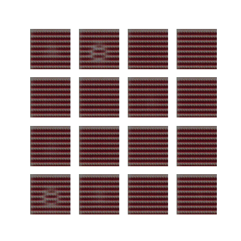

# DCGAN Human Face Generation
*a bittersweeet relic from my grad school days.*

Human face synthesis using a Deep Convolutional Generative Adversarial Network (DCGAN), implemented with TensorFlow and Keras and trained on the CelebA dataset.

The project explores dataset balancing, generator and discriminator architectures, and hyperparameter tuning to improve the quality of generated 128 × 128 facial images.

### Generation Progress

### Model Development

- [Jupyter Notebook](artifacts/model_development.ipynb)
- [HTML Version](artifacts/model_development.html)

*Note: Due to its large file size, the Jupyter notebook cannot be rendered directly on GitHub. The HTML version preserves the notebook's code, experiments, and saved outputs for viewing.*